# frazil

Antarctic sea ice figures from the NSIDC Sea Ice Index, in R.

`frazil` downloads the [NSIDC Sea Ice Index, Version 4](https://nsidc.org/data/g02135)
(data set G02135) for the Southern Hemisphere, computes daily and monthly extent
statistics with a record rule that allows for the 2025 change to the AMSR2 sensor,
builds an Imhof-style terrain from REMA elevation and the SCAR Antarctic Digital
Database, and renders a set of slide figures and an animation in the BRI house
style. Every figure function takes a date and, where it applies, a map window, so
the same set can be drawn for any day in the record and for any region around the
continent.

The package grew out of the figures made for a talk aboard ship during the
2026-27 Antarctic Peninsula field season. The name is the field term for the first
ice crystals that form in open water.

## The figures

Every figure is a 13.333 by 7.5 inch slide. These previews are reduced copies of
the 600 dpi output for 7 October 2026.

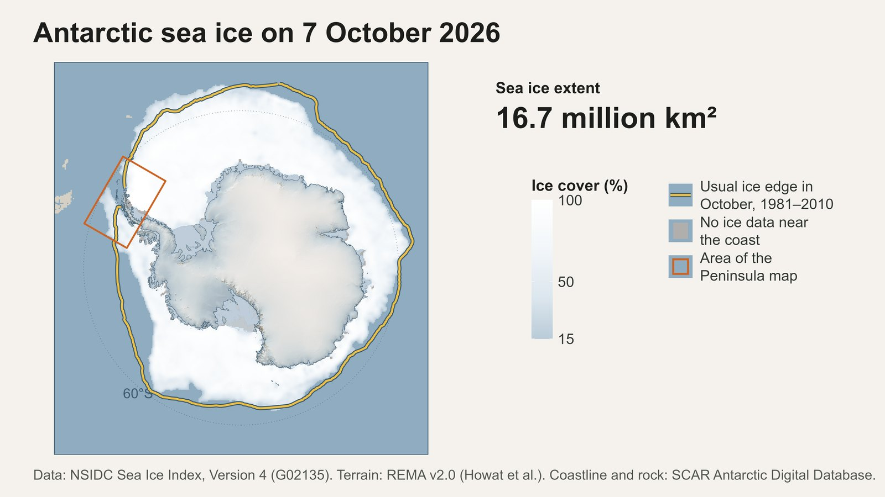

| | |
|---|---|
| 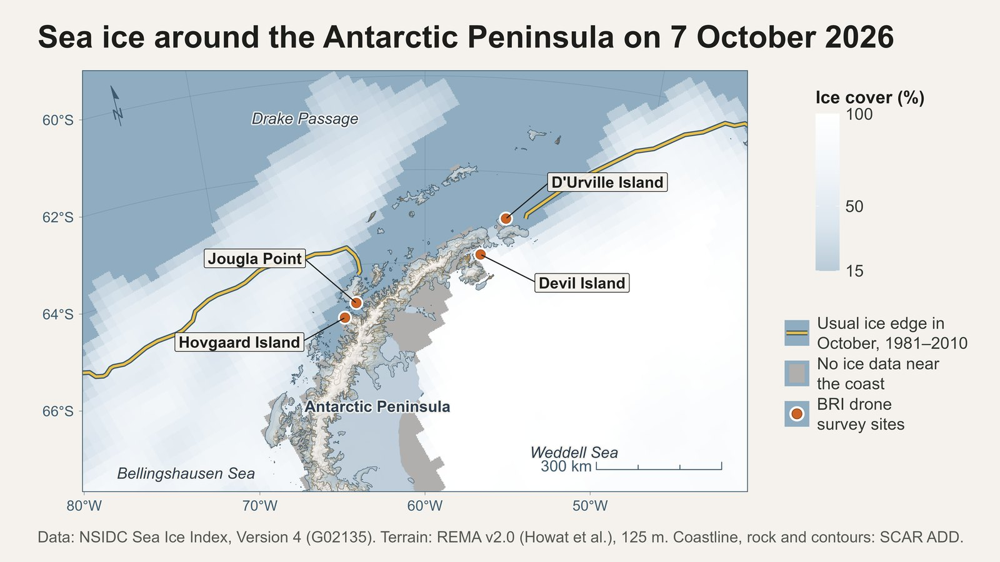 `fig_map_peninsula()` | 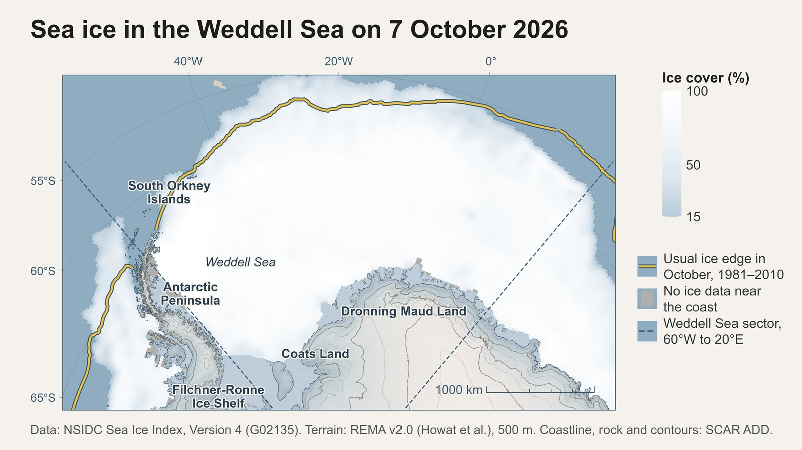 `fig_map_weddell()` |
| 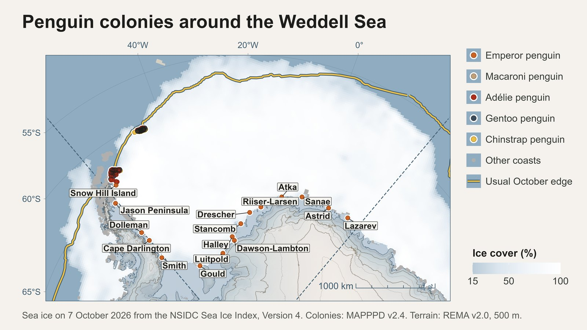 `fig_map_colonies()` | 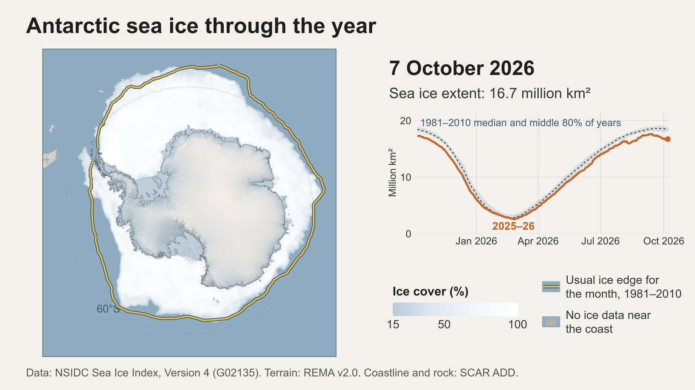 `fig_animation()` |
| 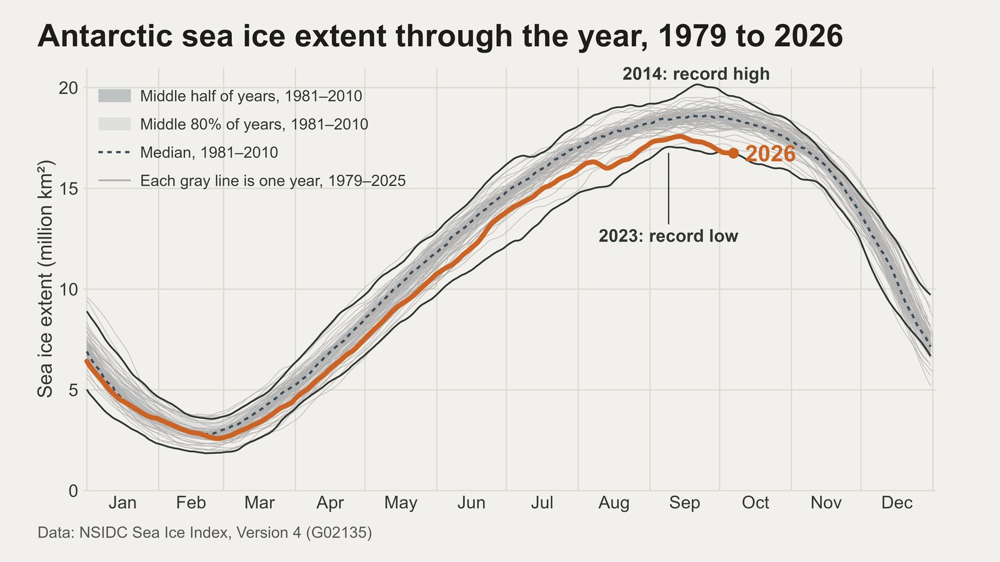 `fig_extent_daily()` | 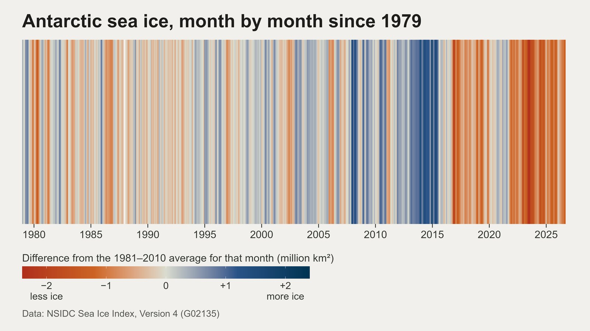 `fig_extent_anomaly()` |
| 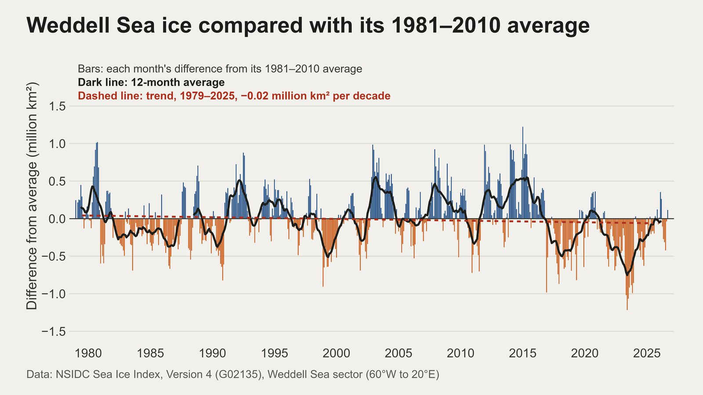 `fig_sector_extent("Weddell")` | 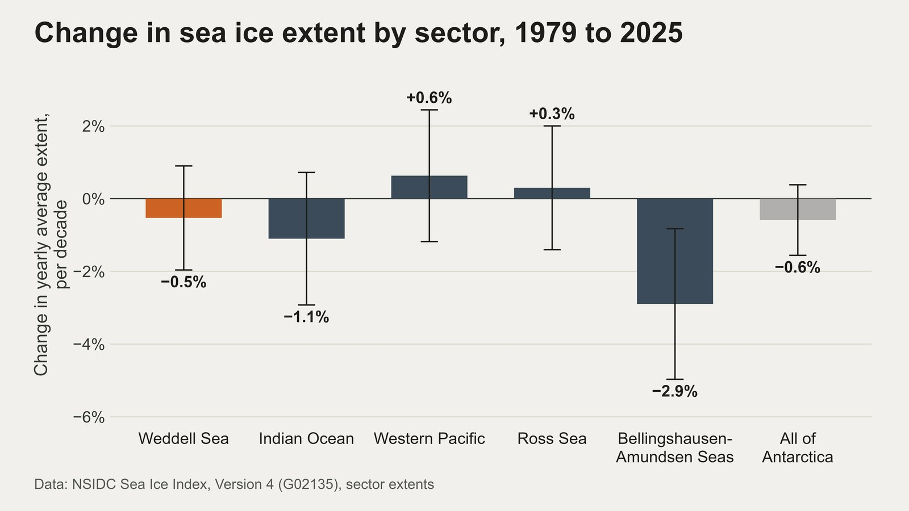 `fig_sector_trends()` |
| 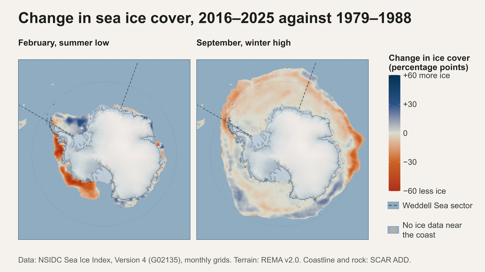 `fig_map_cover_change()` | 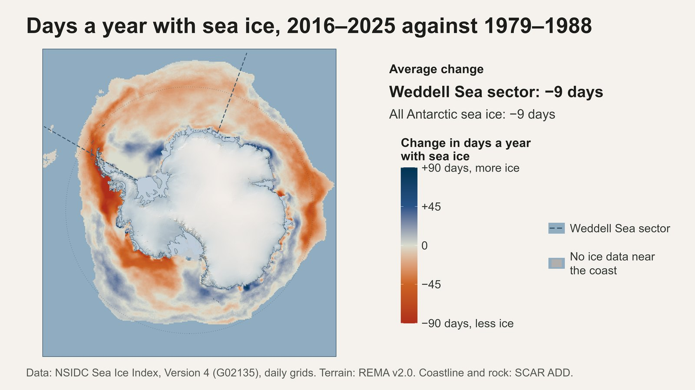 `fig_map_season_change()` |

## Installation

```r
# install.packages("remotes")
remotes::install_github("M-Fox-Wethington/frazil")
```

The colony map needs the `mapppdr` package, which is installed from GitHub with
`remotes::install_github("CCheCastaldo/mapppdr")`. The animation needs
[ffmpeg](https://ffmpeg.org/) on the PATH.

## Setting up

Tell the package where its data lives. Only the cache has a default. The spatial
layers and the elevation models are needed for the maps, and `output` is where the
figure functions write.

```r
library(frazil)
frazil_paths(
  cache   = "D:/seaice/nsidc",            # the NSIDC mirror
  spatial = "D:/seaice/spatial_data",     # the ADD layers, in the bundle layout
  dem_1km = "D:/seaice/rema_mosaic_1km_v2.0_filled_cop30_dem.tif",
  output  = "D:/seaice/figures"
)
```

The four ADD layers are expected under `spatial` in this layout, which is the layout
of the BRI priority-map bundle. Each can also be set on its own.

| Setting | Default under `spatial` | Source |
|---|---|---|
| `coastline` | `Continent_ADD/Antarctica_Coastline_med_res_poly.shp` | ADD v7.3 medium-resolution coastline polygons |
| `iceshelves` | `iceshelves/medium_res_IceShelfs.shp` | ADD ice-shelf polygons |
| `rock` | `add_rock_outcrop/add_rock_outcrop_high_res_polygon_v7.3.shp` | ADD high-resolution rock outcrops |
| `contours` | `add_contours/add_contours_medium_res_v7.3.gpkg` | ADD medium-resolution contours |
| `dem_100m` | `rema_mosaic_100m_v2.0/rema_mosaic_100m_v2.0_filled_cop30_dem.tif` | REMA v2.0 100 m mosaic, for the regional maps |
| `dem_1km` | no default | REMA v2.0 1 km mosaic, for the circumpolar maps |

The ADD layers come from the [SCAR Antarctic Digital Database](https://www.add.scar.org/)
and the REMA mosaics from the
[Polar Geospatial Center](https://www.pgc.umn.edu/data/rema/). The 100 m mosaic is
3.6 GB and the 1 km mosaic about 40 MB.

## Getting the data

```r
nsidc_download()
```

This mirrors the files the package reads into the cache, keeping NSIDC's folder
layout: the daily and monthly extent tables, the 1981-2010 climatology and median
ice edges, the sector workbooks, the daily concentration grids for the last year
and the monthly grids for the last twelve months. A rerun fetches only new or
changed files, so refreshing before a talk costs about 2 MB plus 0.6 MB per new
day. Downloads run in parallel batches.

The two change maps need the full record:

```r
nsidc_download(monthly_all = TRUE, daily_years = c(1979:1989, 2016:2026))
```

That adds every monthly grid since 1978 (about 350 MB) and every daily grid for
those years (about 0.6 MB per day, 4 GB in all).

## Drawing the figures

Each `fig_*()` function builds one slide, writes it to `output` as a 600 dpi PNG
(8000 by 4500 pixels) and a vector PDF, both 13.333 by 7.5 inches, and returns the
plot object. With `date = NULL` the latest grid in the cache is drawn.

```r
fig_extent_daily()                       # extent through the year, every year since 1979
fig_extent_anomaly()                     # one stripe per month against 1981-2010
fig_map_circumpolar()                    # the latest day around Antarctica
fig_map_peninsula()                      # the latest day around the Peninsula, with the BRI sites
fig_map_weddell()                        # the latest day in the Weddell Sea
fig_map_colonies()                       # MAPPPD penguin colonies around the Weddell Sea
fig_sector_extent("Weddell")             # one sector against its 1981-2010 average
fig_sector_trends()                      # the trend in each of the five sectors
fig_map_cover_change()                   # February and September cover, 2016-2025 against 1979-1988
fig_map_season_change()                  # days a year with ice, same periods
fig_animation()                          # one frame per day for a year, as an MP4
talking_numbers()                        # the numbers behind the speaking notes
```

`render_figure_set()` runs all of them for one day. A past day is drawn with
`date = "2026-09-14"`, provided its daily grid is in the cache.

### Other regions

The regional maps are built on a map window. `peninsula_window()` and
`weddell_window()` are the two presets; `polar_window()` centers a frame on a point
and `lonlat_window()` fits one around a longitude-latitude box. A window carries
its projection, its frame, the terrain resolution and exaggeration, and the cell
size the sea ice grid is moved onto.

```r
ross <- lonlat_window(c(lon_min = 150, lon_max = -140, lat_min = -80, lat_max = -60),
                      lon_0 = -175, name = "ross", title = "in the Ross Sea",
                      terrain_res = 500, z_factor = 5, sector = "Ross")
fig_map_region(ross, places = NULL)
```

The first call for a window builds its terrain, which takes about ten minutes at
500 m, and caches it under `terrain_cache` so later calls load it.

## How the numbers are computed

**Five-day means.** Daily extent is smoothed with a five-day trailing mean, the
smoothing NSIDC uses when it reports daily extent and annual maxima and minima.
Each value averages the days with data in the five calendar days ending on that
date, so nothing is carried across the 1987-88 gap.

**The AMSR2 record rule.** Since 1 January 2025 the index has been built from the
AMSR2 sensor, which reads Southern Hemisphere extent up to 0.15 million km² lower
than the SSMIS sensors of the earlier record. `record_year()` therefore counts a
2025 or later value as a record only when it beats the pre-2025 record by more than
0.15 million km², and `talking_numbers()` reports a smaller margin as a tie.

**Sector trends.** Yearly means are built from each month's departure from its
1981-2010 mean, so the two missing months of 1987-88 do not bias a year. Trends are
ordinary least squares fits over 1979-2025 with 95% ranges from the fit.

**Change maps.** The first ten years of the record are compared with the last ten.
Ice cover uses NSIDC's monthly mean grids; the ice season counts days with at least
15% ice in each March-to-February ice year, scaled from the days that have a grid,
and leaves out any year with a gap longer than ten days.

**The alignment guard.** `check_alignment()` compares every grid with the ADD
coastline before a map is drawn, and stops the map when fewer than 97% of the grid's
land cells fall on ADD land or ice shelf, or fewer than 91% of the coastal ocean
cells fall off it. With the grid correctly transformed the shares are 99.2% and
92.6%; reading it in the wrong projection or shifting it one cell drops the ocean
share below 89%.

## Style

The figures follow the BRI figure style: the Dieter Rams palette in `bri_colors`,
`theme_bri()` enlarged for a slide by `theme_slide()`, and the parchment, ocean and
coastline colors of the BRI priority map. The terrain follows the priority map's
recipe: a four-direction Imhof hillshade, an ice ramp and a warm rock ramp wherever
the ADD rock-outcrop layer marks exposed rock, shadows tinted channel by channel,
and contours drawn heavier on shaded slopes. The smallest text on a slide is 14 pt.

## Running the tests

```r
devtools::test()
```

The tests cover the record rule, the five-day mean, the sector statistics, the grid
readers, the change calculations and the alignment guard, all on synthetic data,
so they need none of the downloads.
